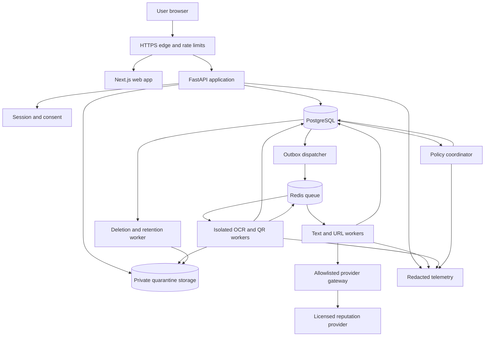
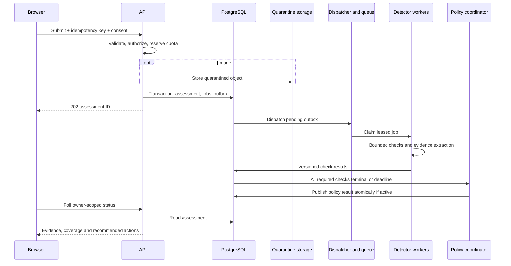

# ProofSentry — System Design
**Version:** 0.1 | **Status:** Proposed architecture | **Date:** 2026-11-25  
**Requirements:** [PRD](PRD.md) · [TRD](TRD.md)

## 1. Architecture decisions
Use a modular monolith (FastAPI) with separate worker execution boundaries and a responsive Next.js web application. Start on CPU, single reviewed cloud region and managed PostgreSQL/object storage; scale individual worker pools before splitting services. No arbitrary target URL retrieval, unrestricted agent tools or user-content publication in MVP. Separate evidence generation from policy decisions; no model can directly choose a final risk label or action. Use versioned contracts and explicit partial results.

## 2. High-level architecture

All arrows indicate logical data/control flows, not unrestricted network access. Media worker can read only its assigned object via scoped storage access, publish bounded results via internal mediated interfaces and has no internet access. Provider gateway is the only external detector egress. API and web use separate identities. The outbox and job records remain the source of truth; Redis is disposable.

### Components and ownership
| Component | Responsibility | Trust boundary |
|---|---|---|
| Edge/web | TLS, size/rate limits, CSP, local redaction, accessible UI | Public; all data untrusted |
| Intake/session | Auth, owner scope, consent, validation, idempotency, quotas | Application |
| Job dispatcher | Transactional outbox, leases, retries, recovery | Internal |
| Media worker | Sandboxed decode, OCR, QR, optional metadata/provenance | Isolated resource-limited pool |
| Text/URL worker | Normalize, rules, compact model, typed findings, reputation adapter | Restricted internal; no arbitrary egress |
| Provider gateway | Allowlisted endpoints, redaction, timeouts, cache, budget | Restricted external boundary |
| Policy coordinator | Coverage-aware concern, evidence merging, localized actions | Trusted versioned deterministic code |
| Data lifecycle | Tombstones, purge, consent withdrawals, backup deletion replay | Privileged narrowly scoped worker |
| Admin/resource review | Reviewed localized resources, policy versions, audit | Separate MFA/RBAC boundary |

## 3. Core sequence

Upload failure leaves no visible assessment; periodic orphan sweeper removes objects created before a failed DB transaction. OCR output triggers text/URL child jobs through a DB outbox, not untrusted instructions. Correction creates a new revision and restarts relevant checks; original findings remain private and expire normally. Cancel/delete revokes active work and prevents late result publication.

### State machines
Assessment: queued → running → completed/partial/failed; queued/running → canceled; any non-deleted state → deleting → deleted. Partial means some checks unavailable but useful evidence exists; failed means no publishable assessment. Completed/partial may carry inconclusive concern. Canceled/deleting/deleted never publish results. Detector job: queued → leased → succeeded/failed/unsupported/skipped; expired lease → queued up to retry budget. Terminal writes are conditional on current lease token and assessment generation. Deadline reconciler marks pending checks unavailable, then invokes policy once; late jobs cannot change published results. Re-analysis is a new revision.

## 4. Data design
PostgreSQL schema (logical; migrations and indexes required). UUID identifiers are opaque, not authorization credentials. All owner-facing queries include owner scope; use foreign keys, unique constraints and row-level security where practical.
| Table | Key fields / invariants |
|---|---|
| principals | id, type (guest/account), oidc_subject_hash nullable, locale, expires_at |
| consent_events | id, principal_id, purpose, notice_version, decision, timestamp; append-only minimal metadata |
| assessments | id, owner_id, parent_id, input_type, country, locale, status, concern, generation, policy_version, expires_at, deleted_at |
| transient_inputs | assessment_id, encrypted_text_or_object_ref, content_type, expires_at; restricted, short-lived |
| jobs | id, assessment_id, generation, detector_key, version, state, lease_token, lease_until, attempts, deadline; unique assessment/generation/detector |
| outbox | id, event_type, aggregate_id, payload_refs, available_at, published_at; no raw content |
| check_results | id, job_id unique, state, coverage, observed_at, duration_ms, provider_version |
| findings | id, check_result_id, code, severity, evidence_kind, redacted_excerpt, span_start/end, source_ref_id, detector_version, limitations |
| source_refs | id, source_type, provider, safe_reference, retrieved_at, expires_at, license_tag |
| assessment_actions | assessment_id, action_code, locale, template_version, priority |
| resources | id, country, locale, official_url, category, reviewed_at, expires_at, version, review_status |
| feedback | id, assessment_id, owner_id, category, consent_event_id, created_at; redacted by default |
| deletion_ledger | request_id, opaque subject reference, requested_at, state, completed_at, backup_expiry; no original content |
| audit_events | id, actor_ref, action_code, target_ref, timestamp, outcome; no submitted text |

Indexes: assessments(owner_id, created_at/id ordering; include created_at in migration), assessments(expires_at), jobs(state, lease_until, deadline), outbox(published_at, available_at), source_refs(expires_at), resources(country, locale, review_status), deletion_ledger(state). Idempotency records keyed by owner + key with request fingerprint, response reference and TTL; do not persist raw input in fingerprints. Use keyed digests for short-lived deduplication, scoped to owner; do not use shared content hashes to reveal others' submissions. Object keys are random, private and scoped; no PII in filenames.

## 5. Analysis pipelines
### Text
Normalize Unicode and whitespace while preserving offset mapping; detect language and script; rules for urgency, credentials, transfer and impersonation indicators; compact model or optional constrained classifier; validate findings against actual spans. Do not treat social context or demographic traits as proof. Use localized reviewed action templates rather than generated instructions. No LLM tools or autonomous decisions.

### URL/QR
Parse strictly; reject non-HTTP(S) and ambiguous syntax; canonicalize host using IDNA, report mixed-script/homograph and misleading userinfo; mask credentials, query values and fragment. Perform deterministic structural checks and, only where approved, provider lookup using minimum necessary domain/URL representation. Never resolve or navigate the user-supplied URL in MVP. Cache only sanitized, licensed provider results with TTL; expired data is not current evidence. Domain-only checks must disclose path-level blind spots. QR is a source of URL/text, not a safe destination.

### Image
Quarantine, validate magic bytes, dimensions and size, safe decode/re-encode inside restricted worker; perform OCR and QR extraction, optionally inspect original provenance within sandbox before stripping metadata. Distinguish low OCR confidence and unsupported scripts. Redact sensitive OCR text before persistence. Provenance states: valid supported manifest, invalid manifest, absent, unsupported or check failed; valid provenance alone does not prove factual truth. No facial identification.

### Future media and business verification
Media adapters accept bounded audio/video and return manipulation indicators, provenance and quality limitations. Require dataset licensing, domain-specific benchmarks, compression/re-recording stress tests and independent review before enabling. Business verification adapters ingest official registry evidence and licensed reviews, preserve jurisdiction, freshness and source attribution, with correction/dispute workflow. Community evidence remains quarantined until moderation. Do not equate absence from a registry or review sentiment with fraud.

## 6. Evidence and policy engine
Typed detector output: check state, indicator code, severity, source kind (observed/heuristic/external/model), safe excerpt, evidence references, version, time, limitations. Source reliability and freshness are configured independently of model text. Group correlated signals (e.g., same URL from OCR and text) so they cannot inflate concern. Public UI shows broad evidence and actionable guidance, not exact internal thresholds.
- High: strong corroborated evidence or applicable fresh trusted harmful reputation; policy must confirm scope and evidence quality.
- Elevated: credible indicators without sufficient corroboration; explicit uncertainty.
- Limited: all mandatory modality checks completed and no material concern; never safe/verified.
- Inconclusive: missing mandatory checks and no sufficient independent evidence, unsupported input, unresolved conflict, or inadequate quality. Strong supported evidence can still yield elevated/high with incomplete coverage.

Policy is versioned and tested against fixed cases; deterministic action selection uses concern, observed indicators, country, locale and recovery context. Rules cannot override evidence integrity or emit public accusations. Store policy version with each result; changing policy does not silently rewrite historical assessments.

## 7. Reliability, security and privacy
- Transactional outbox; at-least-once deliveries; deduplicate by job key, lease token and generation. Bounded queues and deadline reconciler avoid zombie jobs.
- Split text/URL vs media pools, with per-pool concurrency and resource caps. Reject load above capacity with 429/503 and retry guidance; per-provider timeout/circuit breaker.
- Apply TLS, encryption at rest, scoped IAM, secret manager, session/CSRF controls, CSP, immutable deployment artifacts, private DB and object storage. No public storage or unsafe link rendering.
- No external disclosure of raw text/images by default; provider-specific consent/license review for any exceptions. Logs/metrics only redacted categorical values, durations and random request IDs.
- Deletion flow: transaction sets tombstone and increments generation, queues cleanup, revokes access; worker deletes object versions, transient and derived content, feedback links and eligible consented copies; records content-free completion. Backup restore replays deletion ledger before serving; backup expiry disclosed.
- Recovery: daily encrypted DB backups, restore drills, alert on stale queue/deletion lag/provider budget; pilot RPO 24 h, RTO 4 h (targets).
- Incident response: revoke credentials, disable affected detectors, fall back to inconclusive, preserve minimal lawful evidence, notify as required after jurisdictional review, document remediation.

## 8. Deployment topology and scaling
Local Docker Compose: web, API, PostgreSQL, Redis, dispatcher/coordinator, text worker, media worker, storage emulator. Staging/prod use isolated projects, credentials and datasets. Proposed production: GCP-managed container execution, managed SQL, private object storage, managed Redis or evaluated equivalent, gateway and secret manager. Choose a runtime supporting persistent queue consumers or use managed task dispatch with equivalent lease semantics; do not assume serverless request-based containers run indefinite background workers. Separate API and worker identities, sandbox support and workload egress controls are deployment gates.
Initial load target: 1 submission/s at 10 concurrent users for 15 min, 60/25/15% text/URL/image. At 5 s mean service time, Little's law gives ~5 in-flight jobs on average before headroom; actual concurrency depends on fan-out and service distribution. Benchmark per detector, scale on queue age and CPU/memory, cap provider calls and spend. Use budget alerts, autoscaling limits, separate media workers and load shedding. Later add regional data planes only after residency, deletion, routing and operational review.

## 9. Observability and rollout
Metrics: end-to-end latency by modality, queue age, timeout, partial/inconclusive rate, coverage, provider freshness/cost, deletion lag, error rates, and model drift by evaluated locale. No raw content in telemetry. Alert on sustained SLO breach, oldest pending job near deadline, budget exhaustion, purge failures or anomalous abuse. Deploy schema-compatible migrations, staging smoke, canary policy/detector versions, shadow tests and rollback. Run PRD/TRD gates before public launch; never advertise unmeasured detection accuracy.

## 10. Suggested repository layout
```text
docs/                     PRD, TRD, SYSTEM_DESIGN, future ADRs/runbooks
apps/web/                 Next.js UI and accessibility tests
services/api/             FastAPI routes, application, domain, persistence
services/workers/         dispatcher, text/url, media, policy, lifecycle
packages/contracts/       OpenAPI schemas and generated clients
packages/detectors/       versioned adapters and policy fixtures
data/                     dataset manifests/licenses (not private submissions)
evaluation/               benchmark, metrics, adversarial regressions
infra/                    Compose, IaC, deployment config
tests/                    integration, security, E2E, load
.github/workflows/        CI and deployment gates
```

## 11. ADR register and verification
| ADR | Decision | Revisit trigger |
|---|---|---|
| 001 | Modular monolith + isolated workers | Sustained scaling/ownership bottleneck |
| 002 | No arbitrary URL fetch in MVP | Separate threat model and sandbox approval |
| 003 | Deterministic policy over typed evidence | New validated calibration method |
| 004 | Short retention, no training by default | Legal review or consented use case |
| 005 | CPU-first and vendor-neutral adapters | Measured quality/latency gap |
| 006 | Private assessment; moderated public signals deferred | Abuse, dispute and legal controls validated |

Implementation must verify contract compatibility, state transitions and races, tenant isolation, no arbitrary egress, malicious file handling, multilingual evaluation, deletion/restore, load and cost. The architecture is a proposal, not a running system. Unresolved: hosting region and runtime, provider contracts, benchmark results, legal review and approved budget.
